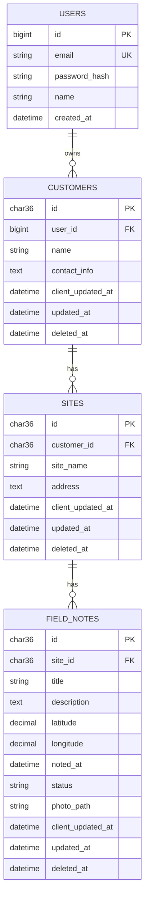

# Field Notes

An offline-first mobile app (Flutter) and REST backend (Spring Boot) for field workers who need to write down notes during site visits.

A user registers, logs in, and then manages **customers → sites → field notes**. Everything keeps working without internet. Changes are saved on the phone first and sent to the server automatically when the connection is back. If the app is reinstalled, logging in again restores everything from the server.

This is my submission for the ATI Limited Mobile Apps take-home task.

## What it can do

- Register and log in (needs internet, JWT based)
- Create, view, edit and delete customers, sites and field notes
- Work fully offline, including create / edit / delete
- Automatic sync when the connection returns, plus a manual "Sync now"
- Restore all data from the server after a reinstall or cleared app data
- Search notes by title, description, site name or customer name
- Filter notes by status and by site (search and filters work together)
- Attach an optional photo (camera or gallery) and the current GPS location
- Proper permission handling for camera and location (explanation first, a clear message on denial, "Open settings" if permanently denied)
- Settings screen with **Default Note Status**, saved locally and used for every new note. It is not synced with the backend, as the task asked.

## Tech stack

| Part | Choice |
|---|---|
| Mobile | Flutter, `flutter_bloc` (BLoC / Cubit) |
| Local storage | SQLite (`sqflite`) for data, `shared_preferences` for settings, `flutter_secure_storage` for the JWT |
| Networking | `dio`, `connectivity_plus` |
| Device | `geolocator`, `image_picker`, `permission_handler` |
| Backend | Java 21, Spring Boot, Spring Security + JWT, Spring Data JPA |
| Database | MySQL, schema managed by Flyway |

I picked SQLite over Hive because the data is relational and I wanted real JOINs for search, the same way the backend does it.

## Project structure

```
field-notes/
├── backend/    Spring Boot API
└── mobile/     Flutter app
```

**Backend** is organised by feature (`auth`, `customer`, `site`, `note`, `sync`, `storage`, `common`), each with its own entity, repository, service, controller and DTOs.

**Mobile** is also feature-first:

```
lib/
├── core/        config, database, network, sync, permissions, storage
└── features/    auth, customers, sites, notes, settings, sync, home
                 (each: data/ + bloc/ + ui/)
```

The rule I followed in the app: **the UI and the blocs only ever read and write the local SQLite database.** They never wait for the server. A separate `SyncService` talks to the backend and keeps the two sides in line. That is what makes it offline-first.

## Database design



Things worth knowing:

- Sites and notes do **not** store a user id or a copy of the customer/site name. Ownership and names are always found by JOINing up the chain (`note → site → customer → user`). Both the search query and the data isolation check use these JOINs.
- The same structure is used in the phone's SQLite database, so the app also shows `customerName` and `siteName` through JOINs and not through duplicated columns.
- IDs of customers, sites and notes are **UUIDs created on the device**. More on why below.
- Nothing is hard deleted. A delete sets `deleted_at` (soft delete).

## Data isolation

Every query on the backend is filtered by the logged-in user, using the JOIN chain above. The user id comes from the JWT, never from the request body. If someone sends an id that belongs to another user, the API answers `404`, exactly as if it did not exist, so nothing leaks.

On the phone, every local row also has a `user_id`. If a different account logs in on the same phone, the local database is wiped first.

## How sync works

This was the part I spent the most time thinking about, so here is the reasoning.

### 1. Client-generated UUIDs

With auto-increment ids, two offline devices could both create "id 1". Child records (a site pointing at a customer) would also need re-mapping after the server hands out real ids. With UUIDs created on the phone, an id is final from the moment it exists, relations never need fixing, and sending the same record twice is harmless.

### 2. Soft deletes

If a delete removed the row, there would be nothing to tell the server (or the user's other devices) that it happened. So a delete just sets `deleted_at` and marks the row as pending. It travels through sync like any other change. After the server confirms, the phone removes the row for good.

### 3. Two timestamps

| Column | Set by | Used for |
|---|---|---|
| `client_updated_at` | The phone, when the user edits | Conflict resolution (last write wins) |
| `updated_at` | The server, when it saves | The pull query (`updated_at > since`) |

I kept them apart on purpose. If pull used the phone's edit time, a change made offline yesterday and pushed today would look "old" to a device that already synced in between, and that device would never receive it.

### 4. The sync run

Order: **push → upload photos → pull → download photos.**

- **Push:** all rows with `sync_status = 'pending'` go in one `POST /api/sync/push`, parents first (customers, sites, notes). The server answers per record: `ACCEPTED`, `SKIPPED` or `REJECTED`. One bad record does not block the others.
- A row is only marked `synced` if its `client_updated_at` is still the same as what was sent. If the user edited it while the request was running, it stays pending.
- **Pull:** `GET /api/sync/pull?since=<serverTime>`. The first pull (or after a reinstall) has no `since`, so it returns everything. That is the restore. The `serverTime` from the response is saved for next time. I use the server's clock here, never the phone's.
- Deleted rows come through pull too, so other devices remove them.
- **Photos** are separate from the data. Metadata goes through sync, the file goes through `POST /api/notes/{id}/photo` after the note exists on the server. Photos taken on another device are downloaded after a pull.

### 5. Conflicts

Last write wins, based on `client_updated_at`. On push the server only applies a change if it is newer than what it has. On pull the phone keeps its own pending edit if it is newer than the server copy. Pushing the same change twice does nothing the second time (equal timestamps count as "not newer"), so retries are safe.

### 6. When sync runs

- On app start
- When connectivity comes back
- About 1.5 seconds after a local change
- Every 2 minutes (to pick up changes from other devices)
- When the user taps the sync icon or "Sync now"

Logging out syncs first, and warns if anything could not be synced, because logout clears local data.

## API overview

All endpoints except `/api/auth/**` need `Authorization: Bearer <token>`.

| Method | Endpoint | Notes |
|---|---|---|
| POST | `/api/auth/register` | returns token |
| POST | `/api/auth/login` | returns token |
| GET | `/api/customers`, `/api/customers/{id}` | |
| PUT | `/api/customers/{id}` | create or update (upsert) |
| DELETE | `/api/customers/{id}` | soft delete, cascades to sites and notes |
| GET / PUT / DELETE | `/api/sites`, `/api/sites/{id}` | `?customerId=` filter |
| GET | `/api/notes` | `?q=&status=&siteId=` |
| GET / PUT / DELETE | `/api/notes/{id}` | |
| POST / GET / DELETE | `/api/notes/{id}/photo` | multipart upload, key `file` |
| POST | `/api/sync/push` | batch of changes |
| GET | `/api/sync/pull` | `?since=<ISO time>` |

Create and update are one `PUT` with the client's UUID in the URL. That makes every write idempotent.

Errors always come back in one shape: `timestamp`, `status`, `error`, `message`, and `fieldErrors` for validation problems.

A Postman collection is in `backend/postman/`.

## Running it

### Backend

You need Java 21, Maven and MySQL.

1. Create the database:
   ```sql
   CREATE DATABASE fieldnotes CHARACTER SET utf8mb4;
   ```
2. Set environment variables (see `backend/.env.example`). Defaults exist for local development, so for a quick start only the DB password may need changing.

   | Variable | Meaning | Default |
   |---|---|---|
   | `DB_URL` | JDBC URL | `jdbc:mysql://localhost:3306/fieldnotes?...` |
   | `DB_USERNAME` | DB user | `root` |
   | `DB_PASSWORD` | DB password | local dev value |
   | `JWT_SECRET` | signing secret, 32+ characters | dev value, **change it** |
   | `PORT` | server port | `8085` |

3. Run it:
   ```bash
   cd backend
   ./mvnw spring-boot:run
   ```
   Flyway creates all tables on the first start. The API is then on `http://localhost:8085`. Uploaded photos are stored in `backend/uploads/`.

### Mobile

You need Flutter and an Android emulator or phone.

1. Open `mobile/lib/core/config/api_config.dart` and check `baseUrl`:
   - Android emulator: `http://10.0.2.2:8085` (already the default)
   - Real phone: your PC's LAN IP, e.g. `http://192.168.1.10:8085`. The phone and PC must be on the same Wi-Fi, and the firewall must allow port 8085.
2. Then:
   ```bash
   cd mobile
   flutter pub get
   flutter run
   ```
3. Release APK: `flutter build apk --release`

Android only. I did not set up iOS.

### Trying the offline flow

1. Register and log in while online.
2. Create a customer, a site and a note.
3. Turn on airplane mode. Create, edit and delete a few things. The sync icon shows how many changes are waiting.
4. Turn airplane mode off. Everything syncs by itself within a few seconds.
5. Log out (or clear the app data), log in again, and all data and photos come back.

## Assumptions and limitations

Being honest about these:

- **Registration and login need internet.** After login the session is stored securely and the app works offline, also after a restart. Logging out clears local data, which is why it syncs and warns first.
- **Last-write-wins relies on device clocks.** If a phone's clock is badly wrong, its edits may wrongly win or lose. A version counter per record would be more robust.
- **A change can be rejected.** For example, a note edited offline whose site was deleted from another device. The record stays pending and the app shows a count of problems. There is no screen yet to resolve these by hand.
- **Editing a deleted record** with a newer timestamp brings it back, but its already-deleted children stay deleted.
- **Photos are stored on the server's local disk.** For real use this should be object storage (S3 or similar). Photos are only checked by file content (JPEG, PNG, WebP), and the picker compresses them before saving.
- **Sync is polling plus connectivity events,** not real-time push.
- **Tokens last 24 hours** and there is no refresh token. When one expires the app sends the user to login but keeps local data so unsynced work is not lost.
- **The app allows plain HTTP** (`usesCleartextTraffic`) so it can talk to a local backend. A real deployment must use HTTPS and turn this off.
- **Text search** uses SQLite `LIKE`, which is only case-insensitive for English letters.
- I did not write automated tests. I tested the flows by hand with Postman and on an emulator.

## Demo

- Demo video: _add link here_
- APK: _add link here_